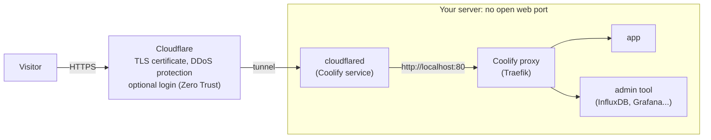

# Publish apps with a Cloudflare Tunnel (Coolify)

Put your apps online **without opening any port** and **without showing the server's IP**.
The server connects *out* to Cloudflare. Nothing connects *in*. It works the same on a VPS and on a
server behind a router (office, home, client site).



| You get | How |
|---|---|
| The server's IP stays hidden | DNS points to Cloudflare, never to the server |
| No open web port | 80/443 closed in UFW, the tunnel goes out only |
| HTTPS for every app | Cloudflare gives visitors the certificate |
| New apps need no new route | one wildcard route `*` → the Coolify proxy |
| A login in front of admin tools | Cloudflare Zero Trust (Access), [step 8](#8-secure-your-public-urls-with-zero-trust) |

**You need:**
- a free Cloudflare account and a domain whose DNS is managed by Cloudflare;
- a server prepared with server-prep and added to Coolify, with the Coolify proxy running.

**Example values used below:** domain `example.com`, server `web-01`, tunnel `apps-tunnel`. Replace them with yours.

> [!WARNING]
> Do **not** turn on the **Cloudflare Tunnel** option in Coolify's **Server** settings. That option moves
> Coolify's own **SSH** connection to the tunnel, and Coolify loses the server if SSH isn't set up for it.
> For apps, run cloudflared as a **service**, as below.

## 1. Create the tunnel in Cloudflare

1. Go to [dash.cloudflare.com](https://dash.cloudflare.com), then **Networking → Tunnels → Create tunnel**.
2. Give it a name (`apps-tunnel`) and click **Create tunnel**.
3. Choose **Docker** and copy the `docker run` command. Keep **only the token**, the long string that
   starts with `eyJ`. Store it in your password manager.

Official docs: [Cloudflare, create a tunnel](https://developers.cloudflare.com/cloudflare-one/networks/connectors/cloudflare-tunnel/get-started/create-remote-tunnel/#1-create-a-tunnel),
[Coolify, create a Cloudflare Tunnel](https://coolify.io/docs/integrations/networking/cloudflare/tunnels/all-resource#1-create-a-cloudflare-tunnel).

> [!CAUTION]
> The token is a password: whoever has it can run your tunnel. Don't paste it in chats, tickets or Git.

## 2. Run cloudflared from Coolify's resource template

1. In Coolify, open a project (for example `infrastructure`), choose the **production** environment,
   and click **+ New**.
2. Search for **Cloudflared**. It is in the **Services** section (one-click templates). Click it.
3. If Coolify asks for a server, choose `web-01` (not `localhost`). Keep the default destination.
4. Coolify creates the service from its template. Nothing to change in it:
   ```yaml
   image: cloudflare/cloudflared:latest
   network_mode: host                # so it reaches the Coolify proxy on localhost:80
   command: tunnel --no-autoupdate run
   environment:
     - TUNNEL_TOKEN=${CLOUDFLARE_TUNNEL_TOKEN}
   ```
5. Fill in:

   | Where | Field | Value |
   |---|---|---|
   | Environment Variables | `CLOUDFLARE_TUNNEL_TOKEN` | the token (`eyJ...`) |
   | General | Name | `cloudflared` (optional) |
   | Domains / ports | | **leave empty**: cloudflared has no web page and opens no port |

6. **Save**, then **Deploy**. In **Logs** you should see 4 lines:
   ```
   Registered tunnel connection connIndex=0 ... protocol=quic
   ...
   Registered tunnel connection connIndex=3 ... protocol=quic
   ```
7. In Cloudflare, the tunnel turns **HEALTHY**.

Official doc: [Coolify, deploy cloudflared](https://coolify.io/docs/integrations/networking/cloudflare/tunnels/all-resource#2-deploy-cloudflared-on-coolify).

## 3. Add a route

In Cloudflare: **Networking → Tunnels →** your tunnel **→ Configure → Routes → Add route →
Published application**.

| Field | Value |
|---|---|
| Subdomain | `demo` to start. Later `*`, so every app goes through the tunnel without a new route |
| Domain | `example.com` |
| Path | empty |
| Service URL | `http://localhost:80` (if you get errors, try `http://127.0.0.1:80`) |

Cloudflare creates the DNS record (`demo` → `<tunnel-id>.cfargotunnel.com`, proxied) for you.
If a record with that name already exists, it does **not** replace it: delete the old record first.

Official docs: [Cloudflare, publish an application](https://developers.cloudflare.com/cloudflare-one/networks/connectors/cloudflare-tunnel/get-started/create-remote-tunnel/#2a-publish-an-application),
[Coolify, configure tunnel routes](https://coolify.io/docs/integrations/networking/cloudflare/tunnels/all-resource#4-configure-tunnel-routes).

## 4. Check the Coolify proxy

In Coolify, go to **Servers →** `web-01`. The proxy must show **Running**.

Official doc: [Coolify, start the proxy](https://coolify.io/docs/integrations/networking/cloudflare/tunnels/all-resource#3-start-coolify-proxy).

## 5. Deploy a demo app

1. In the project, click **+ New → Docker Image**, enter `nginx:alpine`, choose `web-01`, **Continue**.
2. Fill in:

   | Field | Value |
   |---|---|
   | Domains | `https://demo.example.com` |
   | Ports Exposes | `80` |
   | Redirect HTTP to HTTPS (Domains settings) | **Disabled** |

3. **Save**, then **Deploy**.

Why no redirect: the tunnel talks to Coolify in plain HTTP (`localhost:80`), and Cloudflare already gives
visitors HTTPS. With the redirect on, the browser loops (`TOO_MANY_REDIRECTS`).

**Apps that don't listen on port 80:** add the container port to the domain, for example
`https://influxdb.example.com:8086`. The port only tells Coolify where to send the traffic.
Visitors still open `https://influxdb.example.com`.

Official doc: [Coolify, configure your resource domain](https://coolify.io/docs/integrations/networking/cloudflare/tunnels/all-resource#5-configure-your-resource-domain).

## 6. Test

From your workstation:
```bash
curl -sI https://demo.example.com | head -3     # HTTP/2 200 and server: cloudflare
dig +short demo.example.com                     # Cloudflare IPs (104.x, 172.6x.x), not your server
```
The browser shows "Welcome to nginx!".

## 7. Close 80/443 on the server

The apps now come through the tunnel, so the server doesn't need open web ports.

1. Tell server-prep not to open them:
   ```bash
   sudo sed -i 's/^EXPOSE_WEB=.*/EXPOSE_WEB=no/' /etc/server-prep/server-prep.conf
   ```
2. Remove the rules a previous run added. One command at a time: "non-existent rule" just means it
   wasn't there.
   ```bash
   sudo ufw delete allow 80/tcp
   sudo ufw delete allow 443/tcp
   sudo ufw delete allow 443/udp
   sudo ufw route delete allow proto tcp from any to any port 80
   sudo ufw route delete allow proto tcp from any to any port 443
   sudo ufw route delete allow proto udp from any to any port 443
   ```
3. Re-apply the firewall with **server-prep v1.1.1 or later**. Older versions could leave Docker's ports
   outside UFW.
   ```bash
   sudo ./server-prep.sh --config /etc/server-prep/server-prep.conf --only firewall --yes
   sudo iptables -S DOCKER-USER | head -3       # must show: -j ufw-user-forward
   sudo ./server-audit.sh | grep -A1 -E "Docker vs firewall|Exposed TCP"
   ```
4. Check from **outside the server's network**: `https://demo.example.com` still works, but
   `curl -m 5 http://<server-public-ip>` times out.
5. In Cloudflare **DNS → Records**, make sure no `A` / `AAAA` record points to the server's (or the site's)
   public IP. Only the tunnel CNAMEs.

Machines on the same private network (LAN) can still reach the apps directly: ufw-docker lets private
addresses through.

## 8. Secure your public URLs with Zero Trust

Everything behind the tunnel is public by default. For admin tools (InfluxDB, Grafana, database UIs,
the Coolify dashboard...), put a **Cloudflare Access** login in front: visitors must prove who they are
**at Cloudflare**, before any request reaches your server. Zero Trust is free for up to 50 users.

### 8.1 First time only: open Zero Trust

1. Go to [one.dash.cloudflare.com](https://one.dash.cloudflare.com) and choose a **team name**. Your login
   page becomes `<team>.cloudflareaccess.com`.
2. Choose the **Free** plan. Cloudflare may ask for a payment method even for the free plan.
3. Add the email-code login: **Integrations → Identity providers → Add new identity provider → One-time PIN**.
   New accounts don't have it: they only offer the Cloudflare login, limited to members of your Cloudflare
   account, so colleagues listed in the `team` policy could not log in. Users then get a code by email.
   You can add Google, GitHub or Microsoft logins next to it.

Official doc: [Cloudflare, set up One-time PIN](https://developers.cloudflare.com/cloudflare-one/integrations/identity-providers/one-time-pin/#set-up-otp).

### 8.2 A reusable policy for your team

**Access controls → Policies → Add a policy:**

| Field | Value |
|---|---|
| Policy name | `team` |
| Action | **Allow** |
| Session duration | `24 hours` |
| Include | **Emails**: `you@example.com`, `colleague@example.com`, or **Emails ending in**: `@example.com` |

Official doc: [Cloudflare, create a policy](https://developers.cloudflare.com/cloudflare-one/access-controls/policies/policy-management/#create-a-policy).

### 8.3 Protect an app

> [!IMPORTANT]
> With the `*` route, a hostname is public **as soon as an app uses it**. Create the Access application
> **before** you deploy an admin tool, so its setup page (InfluxDB, Grafana...) is never open to everyone.
> Access works even before the app exists.

**Access controls → Applications → Add an application → Self-hosted:**

| Field | Value |
|---|---|
| Application name | `InfluxDB` |
| Public hostname | subdomain `influxdb`, domain `example.com`. Add more hostnames to protect several tools with one app |
| Policies | `team` |
| Login methods | One-time PIN (and the others you added) |

Save. Test in a **private browser window**: Cloudflare's login page appears first, asks for your email,
sends a code, and only then shows the app. From a terminal:
```bash
curl -s -o /dev/null -w '%{http_code}\n' https://influxdb.example.com    # 302: sent to the Cloudflare login
```

Official doc: [Cloudflare, add a self-hosted application](https://developers.cloudflare.com/cloudflare-one/access-controls/applications/http-apps/self-hosted-public-app/#1-add-your-application-to-access).

### 8.4 Machines: service tokens

Scripts and agents (Telegraf, backups, CI) can't type an email code. Give them a **service token**:

1. **Access controls → Service credentials → Service Tokens → Create Service Token**. Name it (`telegraf`),
   pick a duration, and copy the **Client ID** and **Client Secret** (shown once).
2. In the application, add a second policy: Action **Service Auth**, Include **Service Token** → `telegraf`.
3. The machine sends two headers with every request:
   ```
   CF-Access-Client-Id: <client id>
   CF-Access-Client-Secret: <client secret>
   ```
   For Telegraf, see [monitoring.md](monitoring.md#1-protect-the-influxdb-hostname-first).

Official docs: [Cloudflare, create a service token](https://developers.cloudflare.com/cloudflare-one/access-controls/service-credentials/service-tokens/#create-a-service-token),
[Service Auth policy](https://developers.cloudflare.com/cloudflare-one/access-controls/policies/#service-auth).

### Which URLs to protect

| Protect with Access | Keep public |
|---|---|
| InfluxDB, Grafana, database UIs (pgAdmin, Adminer...), Coolify's dashboard if you publish it, staging sites | your public websites and APIs |

Webhooks and API clients (for example GitHub calling Coolify) can't log in. Give them a service token,
or leave that hostname outside the Access application.

## Troubleshooting

| Symptom | Cause | Fix |
|---|---|---|
| Cloudflare page "**Host** Error" (502) | Coolify sends the traffic to the wrong container port | add the port to the domain in Coolify (`https://app.example.com:8086`) and redeploy |
| `404 page not found` | Coolify doesn't know this domain | save the domain on the app and redeploy |
| `TOO_MANY_REDIRECTS` | the app's HTTP → HTTPS redirect is on | set **Redirect HTTP to HTTPS** to **Disabled** |
| The hostname doesn't resolve, or shows an old site | a DNS record with that name already existed | delete it, or set it to CNAME `<tunnel-id>.cfargotunnel.com`, **Proxied** |
| Tunnel not **HEALTHY** | outbound port 7844 (UDP/TCP) blocked by the network | allow it outbound; see [tunnel with firewall](https://developers.cloudflare.com/cloudflare-one/networks/connectors/cloudflare-tunnel/configure-tunnels/tunnel-with-firewall/) |
| Coolify can't reach the server any more | the **Server** setting "Cloudflare Tunnel" was turned on | turn it off and set the server's IP back (Tailscale IP) |
| To find which side fails | | on the server: `curl -s -o /dev/null -w '%{http_code}\n' -H 'Host: app.example.com' http://localhost:80`. `200`/`302` means Coolify is fine, so check the tunnel route |

## Official docs

- Coolify:
  [Cloudflare Tunnel overview](https://coolify.io/docs/integrations/networking/cloudflare/tunnels),
  [all resources through one tunnel](https://coolify.io/docs/integrations/networking/cloudflare/tunnels/all-resource),
  [single resource](https://coolify.io/docs/integrations/networking/cloudflare/tunnels/single-resource),
  [server SSH through a tunnel](https://coolify.io/docs/integrations/networking/cloudflare/tunnels/server-ssh),
  [Cloudflared service](https://coolify.io/docs/services/cloudflared)
- Cloudflare:
  [create a tunnel (dashboard)](https://developers.cloudflare.com/cloudflare-one/networks/connectors/cloudflare-tunnel/get-started/create-remote-tunnel/),
  [tunnel with a firewall](https://developers.cloudflare.com/cloudflare-one/networks/connectors/cloudflare-tunnel/configure-tunnels/tunnel-with-firewall/),
  [self-hosted Access application](https://developers.cloudflare.com/cloudflare-one/access-controls/applications/http-apps/self-hosted-public-app/),
  [service tokens](https://developers.cloudflare.com/cloudflare-one/access-controls/service-credentials/service-tokens/),
  [one-time PIN login](https://developers.cloudflare.com/cloudflare-one/integrations/identity-providers/one-time-pin/)
