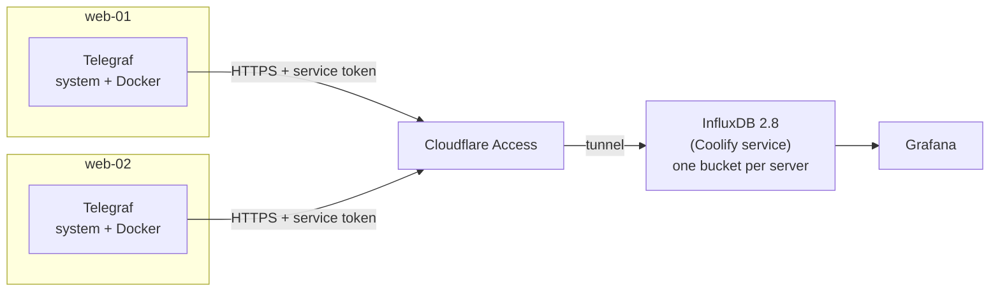

# Server and Docker metrics: Telegraf → InfluxDB 2.8 → Grafana

Every server runs **Telegraf**, which sends its system and Docker metrics to one **InfluxDB 2.8**
(run by Coolify). **Grafana** reads them and shows one dashboard for all servers.



All of it comes from one file, [extras/telegraf/telegraf.conf.example](../extras/telegraf/telegraf.conf.example):

| Metrics | Telegraf inputs |
|---|---|
| CPU, memory, swap, disk, disk I/O, load, processes, uptime | `cpu`, `mem`, `swap`, `disk`, `diskio`, `system`, `processes`, `kernel` |
| Network traffic and TCP connections | `net` (container and VM interfaces dropped), `netstat` |
| Containers: CPU, memory, network, block I/O, status, health | `docker` |
| Interrupts, open files | `interrupts`, `linux_sysctl_fs` |

**Example values used below:** InfluxDB at `https://influxdb.example.com`, organization `example`,
servers `web-01` and `web-02`. Replace them with yours.

**Two ways for Telegraf to reach InfluxDB:**
- **Through Cloudflare** (this guide): InfluxDB is published with the Cloudflare Tunnel
  ([cloudflare-tunnel.md](cloudflare-tunnel.md)) and protected by Cloudflare Access. It works from anywhere.
- **Through Tailscale**: InfluxDB's port 8086 is published on the host and allowed only from the tailnet in
  UFW. Telegraf uses `http://<tailscale-ip>:8086` and needs no Cloudflare headers.

## 1. Protect the InfluxDB hostname first

With the tunnel's `*` route, a hostname is on the internet **as soon as an app uses it**. A new InfluxDB can
show a **Get Started** page where the first visitor creates the admin. So put Cloudflare Access in front of
the hostname **before** deploying InfluxDB: its setup page and its API are then never open to everyone.
[cloudflare-tunnel.md, step 8](cloudflare-tunnel.md#8-secure-your-public-urls-with-zero-trust) explains
Zero Trust.

1. **Service token** for the agents: **Access controls → Service credentials → Service Tokens → Create
   Service Token**, name `telegraf`. Copy the **Client ID** and the **Client Secret** (shown once).
2. **Application:** **Access controls → Applications → Add an application → Self-hosted**, hostname
   `influxdb.example.com`, with two policies:

   | Policy | Action | Include |
   |---|---|---|
   | `team` | Allow | your team's emails (people log in with an email code) |
   | `telegraf` | **Service Auth** | Service Token `telegraf` |

3. Check it, even before InfluxDB exists: Access answers first.
   ```bash
   curl -s -o /dev/null -w '%{http_code}\n' https://influxdb.example.com    # 302: sent to the Cloudflare login
   ```

Official docs: [Cloudflare, create a service token](https://developers.cloudflare.com/cloudflare-one/access-controls/service-credentials/service-tokens/#create-a-service-token),
[add a self-hosted application](https://developers.cloudflare.com/cloudflare-one/access-controls/applications/http-apps/self-hosted-public-app/#1-add-your-application-to-access),
[Service Auth policy](https://developers.cloudflare.com/cloudflare-one/access-controls/policies/#service-auth).

## 2. Run InfluxDB 2.8 on Coolify

1. In Coolify, click **+ New** in your project, search **InfluxDB** (Services), and choose the server.
2. Click **Edit Compose File** and change two things:
   - the image: `influxdb:2.8-alpine` instead of the template's `influxdb:2.7-alpine`;
   - the setup variables: add `DOCKER_` in front of each `INFLUXDB_INIT_...` line. The official image only
     reads `DOCKER_INFLUXDB_INIT_*`. Without the prefix it starts **empty**, with a **Get Started** page where
     the first visitor creates the admin. Also set your organization and the first bucket.

   ```yaml
   image: influxdb:2.8-alpine     # 2.9 is out too, but read "2.9 and later" below first
   environment:
     - SERVICE_URL_INFLUXDB_8086
     - INFLUXDB_HTTP_BIND_ADDRESS=:8086
     - DOCKER_INFLUXDB_INIT_MODE=setup
     - DOCKER_INFLUXDB_INIT_USERNAME=$SERVICE_USER_INFLUXDB
     - DOCKER_INFLUXDB_INIT_PASSWORD=$SERVICE_PASSWORD_INFLUXDB
     - DOCKER_INFLUXDB_INIT_ORG=example
     - DOCKER_INFLUXDB_INIT_BUCKET=web-01
     - DOCKER_INFLUXDB_INIT_RETENTION=30d
     - DOCKER_INFLUXDB_INIT_ADMIN_TOKEN=$SERVICE_PASSWORD_INFLUXDB_TOKEN
   ```
   The first start then creates the admin, the organization and the bucket by itself, on a port that is not
   published, so no setup page is ever online. These values are only used on that first start.
   `SERVICE_PASSWORD_INFLUXDB_TOKEN` is the **operator token** (full access): keep it for admin work, never
   give it to Telegraf or Grafana.
3. Set the domain **with the container port**: `https://influxdb.example.com:8086`. If you see
   **Redirect HTTP to HTTPS**, set it to **Disabled**.
   The tunnel's `*` route already covers it. If you only have named routes, add `influxdb`.
4. **Save**, then **Deploy**. Wait until the container shows **healthy**.
5. Open `https://influxdb.example.com`. Cloudflare asks for your email code first (step 1), then InfluxDB's
   login page: use the user and password that Coolify generated (service → **Environment Variables**:
   `SERVICE_USER_INFLUXDB`, `SERVICE_PASSWORD_INFLUXDB`).

   If you see **Get Started** instead, InfluxDB is empty: the `DOCKER_` prefix was missing, or the service had
   already started once before you added it (the setup variables only work on an empty volume, so adding
   them later changes nothing). Access hides it from the internet, but machines on the server's LAN reach
   Coolify's proxy directly and skip Access. Finish the setup **right away**, from the server, which never
   goes through the network:
   ```bash
   sudo docker exec -it $(sudo docker ps -qf name=influxdb) influx setup
   ```

Official docs: [Coolify, Docker Compose services: domains and ports](https://coolify.io/docs/services/configuration/docker-compose#domains-and-internal-ports),
[InfluxDB, run with Docker Compose](https://docs.influxdata.com/influxdb/v2/install/use-docker-compose/).

**Upgrading an existing 2.7 to 2.8:** change the image and redeploy. The data stays in the service's
volumes. 2.8 adds optional [token hashing](https://docs.influxdata.com/influxdb/v2/reference/config-options/):
turn it on only **after** a first successful start on 2.8, and keep a copy of your tokens first,
because hashed tokens can't be shown again.

**2.9 and later** turn token hashing **on by default**: on the first start, every existing token is hashed
and can never be shown again, the operator token too. Going back to 2.7 afterwards erases all tokens. Before
you move to 2.9, save every token you still need in your password manager (each server's write token,
Grafana's read token, the operator token), and don't roll back. On a new 2.9, each token is shown only once,
when you create it (step 3). See the [InfluxDB release notes](https://docs.influxdata.com/influxdb/v2/reference/release-notes/influxdb/#token-hashing-enabled-by-default).

## 3. Buckets and tokens

In InfluxDB (**Load Data**):

| Create | Settings | Used by |
|---|---|---|
| a **bucket per server**: `web-01`, `web-02`... (the first one was created in step 2) | retention, for example 30 days | Telegraf on that server |
| a **write token per server** | **API Tokens → Generate API Token → Custom API Token**, *Write* on that server's bucket only | Telegraf on that server |
| one **read token** | *Read* on all buckets | Grafana |

One token per server means a leaked token can only write to one bucket, and you can revoke it alone.
Copy each token into your password manager as soon as you create it: InfluxDB may not show it again.

Official docs: [InfluxDB, create a bucket](https://docs.influxdata.com/influxdb/v2/admin/buckets/create-bucket/#create-a-bucket-from-the-load-data-menu),
[create a token](https://docs.influxdata.com/influxdb/v2/admin/tokens/create-token/#create-a-token-in-the-influxdb-ui).

## 4. Install Telegraf on each server

server-prep installs it (step `telegraf`, from the official InfluxData repository) and leaves it **stopped**
until it has an output. If you skipped it, switch the saved answer to `yes` first: with the old `no`, the
step is skipped.
```bash
sudo sed -i 's/^INSTALL_TELEGRAF=.*/INSTALL_TELEGRAF=yes/' /etc/server-prep/server-prep.conf
sudo ./server-prep.sh --config /etc/server-prep/server-prep.conf --only telegraf --yes
```

## 5. Configure Telegraf (on each server)

**a. Secrets**, kept out of the config files:
```bash
sudo nano /etc/default/telegraf
```
```bash
# One VAR=value per line. Comments only on their own line: systemd reads this file
# and keeps anything after the value, so a note at the end of a line breaks it.
INFLUX_TOKEN=<the write token of this server>
# Copy the Client ID as is: it already ends with .access
CF_ACCESS_CLIENT_ID=<client id>
CF_ACCESS_CLIENT_SECRET=<client secret>
```
```bash
sudo chown root:telegraf /etc/default/telegraf && sudo chmod 640 /etc/default/telegraf
```

**b. The config:** one file with the output, the system inputs and Docker. It replaces the package's file.
```bash
sudo cp /etc/telegraf/telegraf.conf /etc/telegraf/telegraf.conf.orig        # keep the original
sudo cp extras/telegraf/telegraf.conf.example /etc/telegraf/telegraf.conf   # from a git clone
# or, from the release files (the template is at the top level there):
# sudo cp telegraf.conf.example /etc/telegraf/telegraf.conf
sudo nano /etc/telegraf/telegraf.conf
```
Change only:

| Setting | Value |
|---|---|
| `urls` | `["https://influxdb.example.com"]` (through Tailscale: `http://<tailscale-ip>:8086`, and remove `http_headers`) |
| `organization` | `example` |
| `bucket` | this server's bucket, `web-01` |
| `hostname` (optional) | the name shown in Grafana; empty = the OS host name |

Leave `token` and `http_headers` as they are: the `${...}` values come from `/etc/default/telegraf`.

If an older setup left an output in `telegraf.d`, remove it, otherwise every metric is sent twice:
```bash
ls /etc/telegraf/telegraf.d/
sudo rm -f /etc/telegraf/telegraf.d/influxdb.conf
```

**c. Let Telegraf read Docker:** the Docker input talks to `/var/run/docker.sock`, which only root and the
`docker` group can open.
```bash
sudo usermod -aG docker telegraf
id telegraf                     # the groups must include "docker"
sudo -u telegraf curl -s --unix-socket /var/run/docker.sock http://localhost/_ping; echo     # OK
```
The service only picks up the new group after a restart (step 6). Don't skip this step: if Telegraf can't
reach Docker, it doesn't start at all and sends no metrics, not even the system ones. On a server without
Docker, delete the `[[inputs.docker]]` block from the config instead.

> [!WARNING]
> Membership of the `docker` group gives the same power as root. It's the usual way to read Docker metrics,
> but only do it on servers where Telegraf comes from the official repository (server-prep checks the key).

## 6. Test, then start

```bash
# Access blocks requests without the token: expect 302
curl -s -o /dev/null -w '%{http_code}\n' https://influxdb.example.com/ping

# With the token, read from the file so nothing shows on screen: expect 204.
# Don't go on until you get 204: the Telegraf test below can't tell if Access refused the token.
# (These two tests are for the Cloudflare way only: skip them with Tailscale.)
sudo bash -c 'set -a; . /etc/default/telegraf; curl -s -o /dev/null -w "%{http_code}\n" \
  -H "CF-Access-Client-Id: $CF_ACCESS_CLIENT_ID" -H "CF-Access-Client-Secret: $CF_ACCESS_CLIENT_SECRET" \
  https://influxdb.example.com/ping'

# One real batch, as the telegraf user (also checks the docker group): expect "Wrote batch of N metrics"
# (--debug: Telegraf only logs that line in debug mode)
sudo -u telegraf bash -c 'set -a; . /etc/default/telegraf; telegraf --config /etc/telegraf/telegraf.conf \
  --config-directory /etc/telegraf/telegraf.d --once --debug' 2>&1 | grep -E 'Wrote batch|E!'

# Docker metrics only: expect "Wrote batch" and no "permission denied"
sudo -u telegraf bash -c 'set -a; . /etc/default/telegraf; telegraf --config /etc/telegraf/telegraf.conf \
  --input-filter docker --once --debug' 2>&1 | grep -E 'Wrote batch|E!'

sudo systemctl enable --now telegraf
sudo systemctl restart telegraf          # picks up the docker group
sleep 20 && sudo journalctl -u telegraf -n 10 --no-pager    # no "E!" lines
```
`telegraf --test` only prints metrics and never sends them. Use `--once` to check the output.

**Check that the data really arrived.** "Wrote batch" only means the server answered OK. If Access refuses
the token, it sends Telegraf to its login page, which also answers OK: Telegraf logs "Wrote batch" and the
metrics are lost. In InfluxDB, open **Data Explorer**, choose this server's bucket and the `cpu`
measurement, and click **Submit**: you should see points from the last few minutes.

## 7. Grafana

**Which URL Grafana uses for InfluxDB:**

| Grafana runs | URL | Cloudflare headers |
|---|---|---|
| on **another server** (or you're not sure) | `https://influxdb.example.com` | yes |
| on **the same server**, as another Coolify resource | `http://<influxdb-container-name>:8086`, after connecting both to the `coolify` network (below) | no |

**Same server: connect the two resources first.** In Coolify, each service has its own private Docker
network, so Grafana can't see the InfluxDB container by default, even in the same project.
1. In the **InfluxDB** service: **General → Connect To Predefined Network**, turn it on, **Save**, **Restart**.
2. Do the same in the **Grafana** service (a Grafana *Application* is already on that network).
3. Get InfluxDB's container name, the hostname to use:
   ```bash
   sudo docker ps --format '{{.Names}}' | grep -i influx
   ```
4. Check that both are on the shared network:
   ```bash
   sudo docker network inspect coolify --format '{{range .Containers}}{{.Name}} {{end}}' | tr ' ' '\n' | grep -iE 'influx|grafana'
   ```

Official doc: [Coolify, service networking](https://coolify.io/docs/services/configuration/networking#choose-the-connection-target).

**Data source:** **Connections → Data sources → Add → InfluxDB**:

| Field | Value |
|---|---|
| Query language | **Flux** |
| URL | from the table above |
| Custom HTTP Headers | only with `https://influxdb.example.com`: `CF-Access-Client-Id` and `CF-Access-Client-Secret` (a service token for Grafana, allowed in the app's Service Auth policy) |
| Organization | `example` |
| Token | the **read** token |

Click **Save & test**: `datasource is working` (or the number of buckets found).

Official doc: [Grafana, configure the InfluxDB data source](https://grafana.com/docs/grafana/latest/datasources/influxdb/configure/).

**Dashboard variables** (one dashboard for all servers):
1. `bucket`: query `buckets()`.
2. `host`:
   ```flux
   import "influxdata/influxdb/schema"
   schema.tagValues(bucket: "${bucket}", tag: "host", start: -1h)
   ```

**Queries that work on every server:**
- always filter `r.host == "${host}"`;
- disk: `r.path == "/"` (device names differ between servers);
- network: `r.interface !~ /^(lo|docker|veth|br-|tailscale)/`;
- CPU: `r.cpu == "cpu-total"`, and show `100 - usage_idle`.

**Container panels:**
```flux
// Memory used by each container (%)
from(bucket: "${bucket}")
  |> range(start: v.timeRangeStart, stop: v.timeRangeStop)
  |> filter(fn: (r) => r._measurement == "docker_container_mem" and r._field == "usage_percent")
  |> filter(fn: (r) => r.host == "${host}")
  |> group(columns: ["container_name"])
  |> aggregateWindow(every: v.windowPeriod, fn: mean, createEmpty: false)
```
```flux
// CPU used by each container (%)
from(bucket: "${bucket}")
  |> range(start: v.timeRangeStart, stop: v.timeRangeStop)
  |> filter(fn: (r) => r._measurement == "docker_container_cpu" and r._field == "usage_percent")
  |> filter(fn: (r) => r.host == "${host}" and r.cpu == "cpu-total")
  |> group(columns: ["container_name"])
  |> aggregateWindow(every: v.windowPeriod, fn: mean, createEmpty: false)
```
```flux
// Containers that are not healthy (table)
from(bucket: "${bucket}")
  |> range(start: -5m)
  |> filter(fn: (r) => r._measurement == "docker_container_health" and r._field == "health_status")
  |> filter(fn: (r) => r.host == "${host}")
  |> last()
  |> filter(fn: (r) => r._value != "healthy")
  |> keep(columns: ["container_name", "_value"])
```

## Troubleshooting

| Symptom | Cause | Fix |
|---|---|---|
| `302` with the token | the token isn't allowed, or the headers aren't sent | the app needs a **Service Auth** policy with this token; check the two names in `http_headers` |
| `403 Forbidden` from Cloudflare | the token is expired or was revoked | create a new one and update `/etc/default/telegraf` |
| `401 Unauthorized` from InfluxDB | wrong InfluxDB token | use this server's write token |
| `404` / `bucket not found` | wrong bucket or organization | check `bucket` and `organization` (case matters) |
| "Wrote batch" but no data in the bucket | Access refused the token and sent Telegraf to its login page, which answers OK | run the `204` test of step 6; check the **Service Auth** policy and the two names in `http_headers` |
| Telegraf doesn't start, no metrics at all (`E! [agent] Starting input inputs.docker`, `permission denied ... docker.sock`) | telegraf isn't in the `docker` group, the service wasn't restarted, or the server has no Docker | `sudo usermod -aG docker telegraf && sudo systemctl restart telegraf`; without Docker, delete `[[inputs.docker]]` |
| Every metric twice in Grafana | two outputs: the full config **and** an old `telegraf.d/influxdb.conf` | delete the one in `telegraf.d` and restart |
| InfluxDB grows very fast | Docker labels turned into tags | keep `docker_label_include` limited to the compose labels, as in the template |
| Cloudflare "Host Error" (502) | the InfluxDB domain has no `:8086` in Coolify | `https://influxdb.example.com:8086`, then redeploy |
| Grafana: `no such host` / `dial tcp ... lookup` with the container URL | Grafana and InfluxDB don't share a Docker network | turn on **Connect To Predefined Network** on both services, restart them, or use the public URL with the headers |
| `permission denied` on disk mounts (`/run/user/...`, `netns`) | normal for some mounts | harmless; optionally extend `ignore_fs` in `[[inputs.disk]]` |

## Official docs

- InfluxDB: [install (Docker)](https://docs.influxdata.com/influxdb/v2/install/),
  [create a token](https://docs.influxdata.com/influxdb/v2/admin/tokens/create-token/),
  [config options (token hashing)](https://docs.influxdata.com/influxdb/v2/reference/config-options/),
  [Coolify InfluxDB service](https://coolify.io/docs/services/influxdb),
  [Coolify service networking](https://coolify.io/docs/services/configuration/networking)
- Telegraf: [InfluxDB v2 output](https://github.com/influxdata/telegraf/tree/master/plugins/outputs/influxdb_v2),
  [Docker input](https://github.com/influxdata/telegraf/tree/master/plugins/inputs/docker),
  [network input](https://github.com/influxdata/telegraf/tree/master/plugins/inputs/net)
- Cloudflare: [service tokens](https://developers.cloudflare.com/cloudflare-one/access-controls/service-credentials/service-tokens/),
  [self-hosted Access application](https://developers.cloudflare.com/cloudflare-one/access-controls/applications/http-apps/self-hosted-public-app/)
- Grafana: [InfluxDB data source](https://grafana.com/docs/grafana/latest/datasources/influxdb/)
